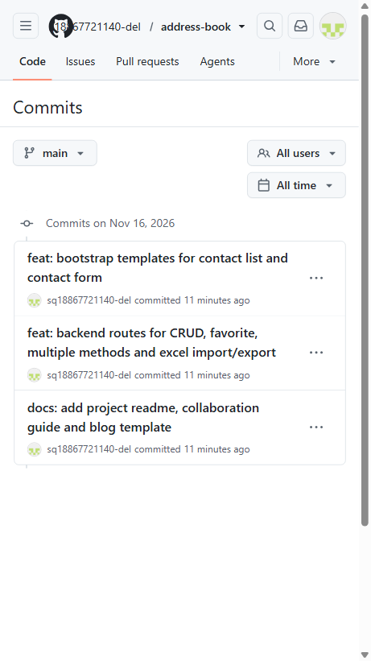
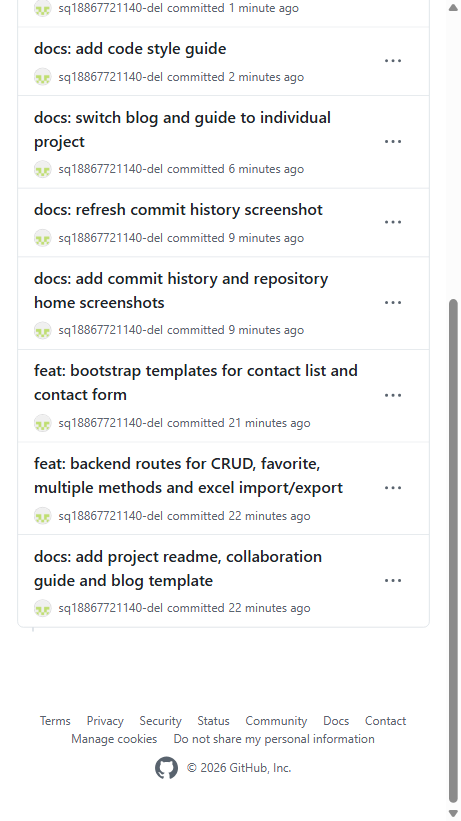
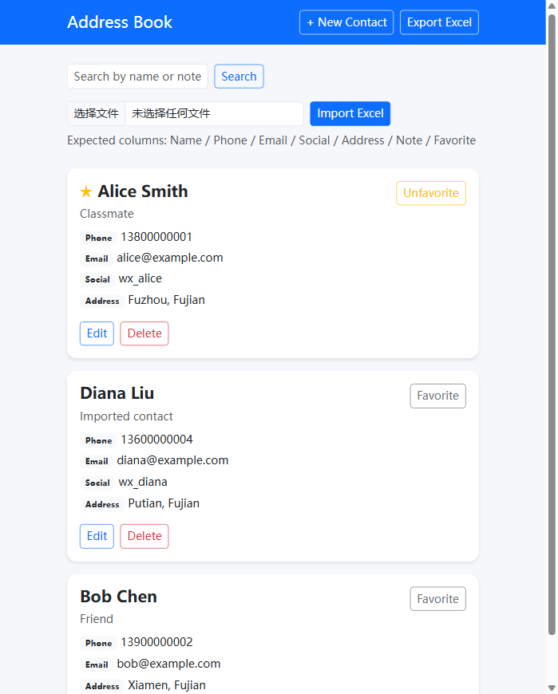
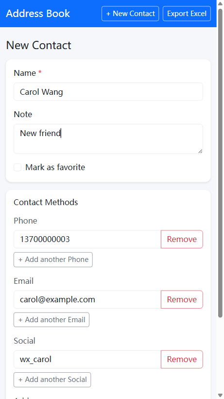
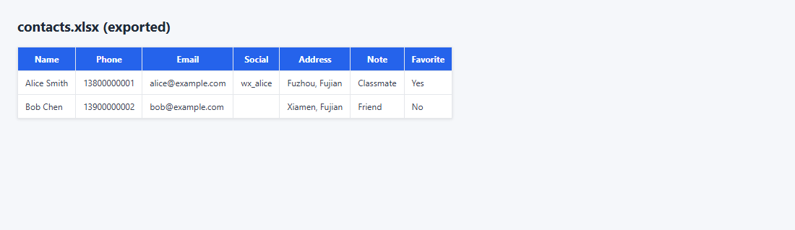
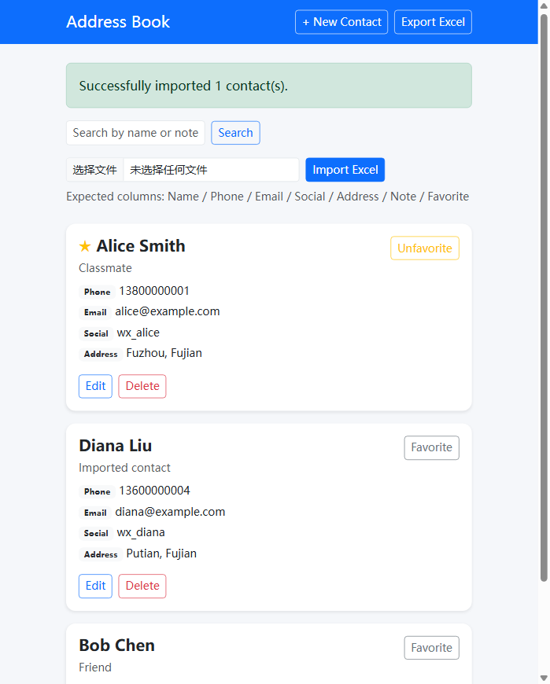

# EE308 Extreme Programming Assignment: Address Book System

## Assignment Description

| Item | Content |
| --- | --- |
| Course for This Assignment | Software Engineering (FZU–MU) |
| Project Type | Individual project |
| Assignment Requirements | Build a web address book: favorite contacts, bind multiple contact methods to one contact, Excel import/export, optional cloud deployment; complete Git version-controlled development and submit an individual blog. |
| Objectives of This Assignment | Experience the extreme programming development workflow; practice module division, Git version control, feature design rationale, and project retrospective. |
| Other References | Flask official docs, openpyxl docs, Bootstrap docs; course requirement Programming.docx |

## Table of Contents

- [1. Project Links](#1-project-links)
- [2. Commit History Statistics](#2-commit-history-statistics)
- [3. Implementation Approach](#3-implementation-approach)
- [4. Screenshots and Video](#4-screenshots-and-video)
- [5. PSP Time Table](#5-psp-time-table)

---

## 1. Project Links

- GitHub repository: https://github.com/sq18867721140-del/address-book
- Cloud deployment URL (optional extra-credit item): (Paste public URL; localhost does not count)
- Code style guide: [codestyle.md](codestyle.md)
- Other links: (Release tag link, etc.)

## 2. Commit History Statistics

> Total commits: **10** (all by the repository owner). Screenshots of the GitHub commit history are shown below.

| Author | Commits | Main Contributions |
| --- | --- | --- |
| sq18867721140-del | 10 | Backend routes, favorite, multiple methods, Excel import/export, search filter, templates, documentation |

**Commit history (top):**

**Commit history (bottom):**

## 3. Implementation Approach

### 3.1 Module Division

- Data layer: two SQLite tables, `contact` and `contact_method` (one-to-many).
- Business layer: Flask routes handle CRUD, favorite toggle, and Excel read/write.
- Presentation layer: Jinja2 templates + Bootstrap render the list and form.

### 3.2 Favorite Contacts (25 points)

- The `is_favorite` field marks a contact; the list query sorts by `is_favorite DESC` so favorites appear on top.
- Clicking "Favorite / Unfavorite" toggles the flag and refreshes the star and button label.

### 3.3 Multiple Contact Methods (10 points)

- One contact has many methods, typed as phone, email, social, or address.
- The form groups methods by type; multiple entries can be added or removed dynamically; they are saved to the database in batches by type.

### 3.4 Excel Import / Export (25 points)

- Export: openpyxl generates `contacts.xlsx` with headers Name / Phone / Email / Social / Address / Note / Favorite, one row per contact; multiple methods of the same type are separated by line breaks in the cell.
- Import: reads a file in the same format, locates columns by header, skips rows without a name, and appends valid records; line breaks in a cell are split into separate methods.

### 3.5 Page Style (10 points)

- Bootstrap 5 card layout, top navigation bar, flash messages, favorite star and button state indicators.

### 3.6 Cloud Deployment (Optional +15)

> If completed: record the cloud vendor, deployment method (Gunicorn + Nginx, etc.) and public URL. Delete this section if skipped.

## 4. Screenshots and Video

### 4.1 Screenshots

**Contact list page (favorite pinned on top, multiple methods per contact):**

**Create / edit form page (multiple contact methods, add/remove dynamically):**

**Exported Excel content:**

**Import result:**

### 4.2 Full Running Video

The complete demo shows: create a contact → add multiple methods → favorite and pin → export Excel → import Excel.

<video controls width="100%">
  <source src="videos/demo-video.mp4" type="video/mp4">
  Your browser does not support the video tag. Please download the video:
  <a href="videos/demo-video.mp4">videos/demo-video.mp4</a>
</video>

> Note: the video file is large; if the GitHub repository cannot hold it, upload it to a cloud drive / video host and paste the public link here instead.

## 5. PSP Time Table

> Total duration: about 5 hours (300 minutes). Estimated and actual times are listed per phase.

| PSP Phase | Estimated Time (min) | Actual Time (min) |
| --- | --- | --- |
| Planning · Requirements understanding and estimation | 30 | 30 |
| Design · Module division and data model | 40 | 45 |
| Coding · Feature implementation | 150 | 150 |
| Testing · Self-test and bug fixing | 40 | 45 |
| Recording · Blog writing and material preparation | 40 | 30 |
| **Total** | **300** | **300** |
